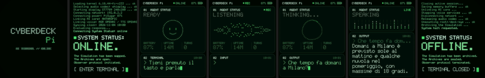
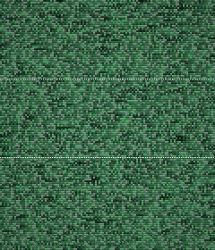
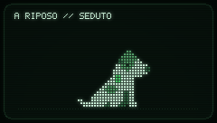
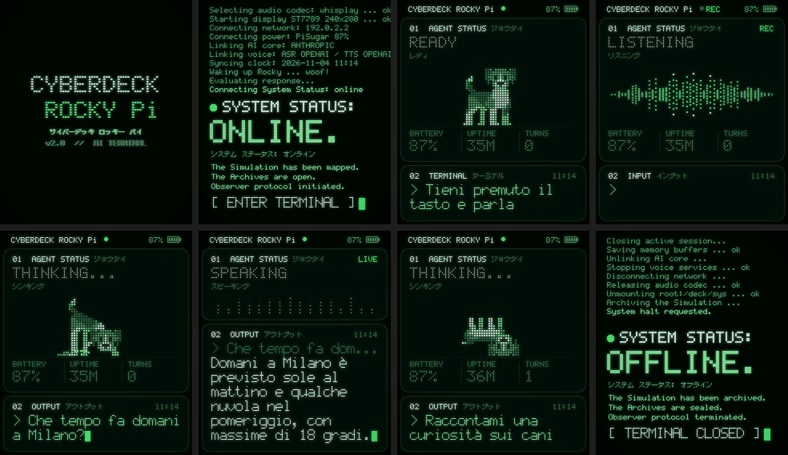
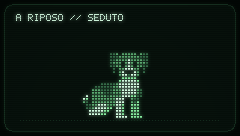

# CYBERDECK ROCKY Pi v1.0

サイバーデッキ ロッキー パイ — L'interfaccia del display **PiSugar Whisplay** di Assistant-PAi:
una dashboard **dot-matrix** minimal a card, con i colori verdi di un vecchio monitor a fosfori.
Il progetto è dedicato a **Rocky**, il Jack Russell che vive sullo schermo.
Sostituisce solo la grafica del [whisplay-ai-chatbot](https://github.com/PiSugar/whisplay-ai-chatbot):
voce, AI, pulsante e batteria funzionano come prima.



*Logo all'accensione, terminale di avvio, Rocky in attesa, in ascolto, Rocky che si dà da fare
mentre l'assistente elabora, risposta, un'altra elaborazione, spegnimento. Le immagini sono generate
dal codice con `deck_preview.py`.*



## Cosa fa

### Rocky, il Jack Russell
Rocky è disegnato in pixel art, a puntini, con i tratti del Jack Russell:
- corpo bianco;
- macchie marroni su orecchie, occhi e dorso;
- orecchio piegato in avanti e coda corta e dritta;
- collare verde.

**Mentre aspetta un comando** Rocky scodinzola, respira e sbatte gli occhi. Ogni pochi secondi fa
a caso una di queste cose, senza ripetere la stessa due volte di fila:
- **si siede**, apre la bocca e **tira fuori la lingua** ansimando, poi la richiude e si rialza;
- **fa un giro:** si gira a sinistra, cammina, si ferma, si rigira e torna al suo posto;
- **schiaccia un pisolino:** si sdraia, chiude gli occhi (escono le "z"), sbatte gli occhi e si rialza.

**Mentre l'assistente elabora** la tua richiesta, Rocky si dà da fare. A ogni pressione del tasto
sceglie a caso un'attività diversa dalla volta precedente:
- **scava:** la terra vola dietro di lui e si accumula in un mucchietto;
- **salta:** si abbassa, salta con le zampe distese e atterra ammortizzando, con l'ombra sul
  pavimento che si stringe;
- **si rotola a pancia in su** e si struscia la schiena agitando le zampe.



*Le sei animazioni di Rocky: seduto con la lingua di fuori, giro, pisolino (a riposo); scavo,
salto, rotolata (mentre l'assistente elabora).*

### Animazioni che seguono l'assistente
La card **01 AGENT STATUS** mostra il titolo dello stato, la sua traduzione in **katakana** e
un'animazione:

| Stato | Titolo | Katakana | Animazione |
|---|---|---|---|
| pronto | `READY` | レディ | Rocky in attesa (vedi sopra) |
| tieni premuto il tasto e parli | `LISTENING` | リスニング | forma d'onda a barre di puntini, `● REC` lampeggia |
| trascrizione / elaborazione | `DECODING...` / `THINKING...` | デコード / シンキング | Rocky scava, salta o si rotola |
| risposta a voce | `SPEAKING` | スピーキング | barre di puntini che "parlano" |
| errore | `ERROR` | エラー | puntini dispersi che tremolano |

Rocky, l'onda e le barre sono fatti degli **stessi 384 puntini**, che **scivolano** da una forma
all'altra. Così Rocky si scioglie nell'onda quando premi il tasto, e l'onda torna Rocky quando
lo rilasci. Anche tra una posa e l'altra di Rocky i puntini scorrono, quindi non ci sono scatti.
Il resto della pagina cambia allo stesso modo:
- il titolo si "decodifica" lettera per lettera;
- le card si allargano e si restringono con un movimento morbido;
- Rocky si ridimensiona con loro.

Da fermi, Rocky e i suoi puntini stanno su una griglia regolare di passo intero. I pallini
(stato, `REC`, `SYSTEM STATUS`) sono dischi perfettamente rotondi.

### Katakana
Il nome ha la sua traduzione **サイバーデッキ ロッキー パイ** sotto il logo. I katakana compaiono anche:
- sotto ogni stato;
- accanto alle etichette delle card (ジョウタイ, インプット, アウトプット, ターミナル...);
- nel terminale di avvio (システム ステータス: オンライン).

Il font katakana è disegnato a mano a puntini, come il resto.

### Card 02: il terminale
Mostra:
- la tua domanda (`> ...`);
- la risposta, scritta carattere per carattere **in sincronia con la voce**;
- da fermo, l'invito a premere il tasto.

Le immagini generate dall'AI vengono ricostruite a puntini in una card **03 VISION**.

### Accensione
1. Glitch iniziale, poi il logo **CYBERDECK ROCKY Pi** con katakana e versione (o il tuo logo)
   compare tra i disturbi e sparisce con un altro glitch.
2. Righe di codice che scorrono, con dati veri: kernel, rete, batteria, servizi AI.
3. `● SYSTEM STATUS:` / **`ONLINE.`** / `システム ステータス: オンライン` / tre righe di testo /
   `[ ENTER TERMINAL ] █`.
4. Un taglio glitch porta alla dashboard, che si accende dall'alto come un tubo catodico.

### Spegnimento
Quando spegni o riavvii il Raspberry (anche dal pannello web o con il tasto della PiSugar):
1. righe di codice di chiusura;
2. `SYSTEM STATUS:` / **`OFFLINE.`** / `[ TERMINAL CLOSED ]`;
3. il logo compare e sparisce con il glitch;
4. lo schermo si spegne come un vecchio CRT: si schiaccia in una riga e poi in un punto.

Accensione e spegnimento hanno anche **effetti sonori** (si possono disattivare).

## CYBERDECK ROCKY Pi v2.0

La versione **v2.0** è identica alla v1.0 (stessa dashboard, stesse animazioni, stesse sequenze di
accensione e spegnimento, stesso pannello), ma ha un **nuovo Rocky**. È ridisegnato
dall'illustrazione di riferimento, in vista di tre quarti con il muso rivolto verso chi guarda:
- orecchie cadenti marroni aperte ai lati della testa;
- lista bianca al centro del muso, occhi grandi, naso nero;
- petto bianco con le ombre lavanda, corpo marrone con la sella scura;
- coda alta con la punta bianca.

Tutte le sue animazioni sono ridisegnate in questo stile: seduto con la lingua, giro, pisolino,
scavo, salto e rotolata.





Demo completa: [cyberdeck-v2-demo.gif](anteprime/cyberdeck-v2-demo.gif)

**Come sceglierla:**
- dal pannello web, *Interfaccia → CYBERDECK ROCKY Pi v2.0*;
- oppure nel `.env` con `UI_STYLE=cyberdeck2`.

Per tornare alla v1.0: `UI_STYLE=cyberdeck`.

## Installazione (sul Raspberry Pi)

Prima completa la [GUIDA](../GUIDA.md) fino alla Fase 7 (chatbot funzionante). Poi:

```bash
cd ~
git clone -b claude/raspberry-pi-ai-assistant-vlgr75 https://github.com/retroCyberdan/Assistant-PAi.git
bash ~/Assistant-PAi/cyberdeck/install.sh
```

Se il repository è già sul Raspberry, aggiornalo invece di clonarlo:
`cd ~/Assistant-PAi && git pull && bash cyberdeck/install.sh`.

Lo script:
1. salva l'interfaccia originale in `python/chatbot-ui.original.py`;
2. **rimuove le versioni precedenti** (interfacce Videotex / cyberpunk e il vecchio pannello);
3. copia i file `deck_*.py` in `whisplay-ai-chatbot/python/` e installa un piccolo lanciatore al posto
   di `chatbot-ui.py`;
4. **pulisce il file `.env`** dalle vecchie voci `VTX_*` (copia di sicurezza in `.env.bak`). Le chiavi
   API non vengono toccate;
5. installa il **pannello web**: chiede la password (o mantiene quella che avevi) e crea il servizio
   `cyberdeck-panel`;
6. riavvia l'assistente.

Non serve ricompilare (`build.sh`): CYBERDECK è solo Python e usa librerie già installate dal chatbot
(Pillow, numpy, Flask).

**Per tornare all'interfaccia originale** hai due strade:
- dal pannello web scegli *Interfaccia → Originale PiSugar*;
- oppure esegui `bash ~/Assistant-PAi/cyberdeck/uninstall.sh`.

**Per aggiornare il chatbot** (`git pull` nella cartella `whisplay-ai-chatbot`):
1. esegui prima `uninstall.sh`;
2. fai `git pull` e `bash build.sh`;
3. esegui di nuovo `install.sh`.

## Pannello web

Dal browser di un telefono o di un PC sulla stessa rete Wi-Fi: **`http://pai.local:8080`** (oppure
`http://<indirizzo-IP>:8080`).

Dal pannello puoi:
- **caricare il tuo logo** (PNG/JPG). Viene ricostruito a puntini e mostrato all'accensione e allo
  spegnimento al posto della scritta;
- cambiare **nome** (es. `CYBERDECK ROCKY Pi`: la prima parola va in grande, il resto sotto in
  evidenza) e la sua **traduzione in katakana**;
- scegliere i **colori**: verde fosforo, ambra o ghiaccio;
- modificare i **testi**: frase della pagina iniziale, righe di accensione e spegnimento, prompt finale;
- regolare gli **effetti**: animazioni di accensione e spegnimento (completa / rapida / nessuna), suoni,
  glitch a riposo, effetto CRT, velocità del testo;
- vedere l'**anteprima del display** prima di salvare;
- **salvare e riavviare** l'assistente, **riavviare** o **spegnere** il Raspberry;
- cambiare la password.

Sicurezza:
- accesso con password; dopo 5 tentativi sbagliati l'accesso si blocca per un minuto;
- i moduli sono protetti contro le richieste falsificate (CSRF);
- il pannello modifica solo le voci `UI_STYLE` e `DECK_*` del `.env`, sempre con una copia `.env.bak`;
- usa un permesso `sudo` limitato a tre comandi: riavviare l'assistente, riavviare e spegnere il
  Raspberry.

Il pannello usa HTTP semplice: usalo **solo sulla rete di casa**.

Password dimenticata? Dal Raspberry: `python3 ~/whisplay-ai-chatbot/python/deck_panel.py --set-password`.

## Impostazioni (file `~/whisplay-ai-chatbot/.env`)

Si cambiano dal pannello web; a mano funzionano così:

```ini
UI_STYLE=cyberdeck
# cyberdeck = v1.0, cyberdeck2 = v2.0 (nuovo Rocky), original = interfaccia PiSugar
DECK_NAME=CYBERDECK ROCKY Pi
DECK_NAME_KANA=サイバーデッキ ロッキー パイ
DECK_PALETTE=verde
DECK_HINT=Tieni premuto il tasto e parla
DECK_BOOT=full
DECK_SHUTDOWN=full
DECK_BOOT_LINES=The Simulation has been mapped.|The Archives are open.|Observer protocol initiated.
DECK_SHUTDOWN_LINES=The Simulation has been archived.|The Archives are sealed.|Observer protocol terminated.
DECK_ENTER_TEXT=[ ENTER TERMINAL ]
DECK_SOUND=1
DECK_CRT=0.7
DECK_GLITCH=0.2
DECK_TEXT_SPEED=60
```

Note sulle voci:
- `UI_STYLE`: `cyberdeck` (v1.0), `cyberdeck2` (v2.0) oppure `original`;
- `DECK_PALETTE`: `verde`, `ambra` oppure `ghiaccio`;
- `DECK_BOOT` e `DECK_SHUTDOWN`: `full`, `quick` oppure `off`;
- `DECK_CRT` e `DECK_GLITCH`: da 0 a 1;
- `DECK_TEXT_SPEED`: caratteri al secondo.

Altre voci:
- `DECK_LOGO_IMAGE=/percorso/logo.png` usa un logo personalizzato (il pannello lo salva in
  `~/.config/cyberdeck/logo.png`);
- `DECK_AUDIO_DEVICE` serve solo se i suoni escono dal dispositivo sbagliato.

Dopo una modifica a mano: `sudo systemctl restart chatbot.service`.

## Provarlo sul PC (senza Raspberry)

```bash
pip install pillow numpy
python3 deck_preview.py demo anteprime          # sessione completa: GIF + immagini
python3 deck_preview.py snapshot prova.png      # pagina iniziale + risposta
DECK_PALETTE=ambra DECK_NAME="NEURODECK X" python3 deck_preview.py snapshot prova.png
```

## Come funziona

Il chatbot originale ha due processi:
- **Node.js** gestisce microfono, AI e voce;
- **Python** disegna sul display.

I due comunicano con messaggi JSON su `localhost:12345`. `deck_ui.py` parla lo stesso protocollo,
quindi il resto del chatbot non va modificato.

Quando il sistema si spegne, `systemd` invia all'interfaccia il segnale di arresto: CYBERDECK lo
intercetta, mostra l'animazione di spegnimento e poi esce.

| File | Contenuto |
|---|---|
| `deck_ui.py` | protocollo socket, dashboard, transizioni, accensione e spegnimento, suoni |
| `deck_dog.py` | Rocky v1.0: sprite pixel art, pose, animazioni a riposo e durante l'elaborazione |
| `deck_dog2.py` | Rocky v2.0: nuova grafica (vista di tre quarti), stesse animazioni |
| `deck_gfx.py` | font dot-matrix, card, forme a puntini e morph, immagini a puntini, glitch, CRT |
| `deck_font.py` | font bitmap originale: lettere latine 5x7 con accenti italiani e katakana 7x7 |
| `deck_panel.py` | pannello web (Flask) |
| `deck_preview.py` | anteprime e demo animata senza hardware |
| `install.sh` / `uninstall.sh` | installazione, migrazione dalle versioni precedenti, ripristino |

File creati sul Raspberry:
- `~/whisplay-ai-chatbot/python/deck_*.py`, cioè i moduli;
- `~/.config/cyberdeck/`, con password del pannello e logo;
- i servizi `cyberdeck-panel.service` e `/etc/sudoers.d/cyberdeck`.

Se avevi usato le vecchie interfacce, il logo caricato allora è rimasto in `~/pai-assets/`: se non
ti serve più, puoi cancellare la cartella con `rm -r ~/pai-assets`.
