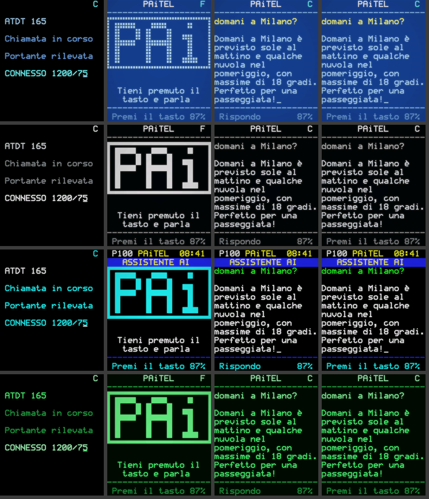
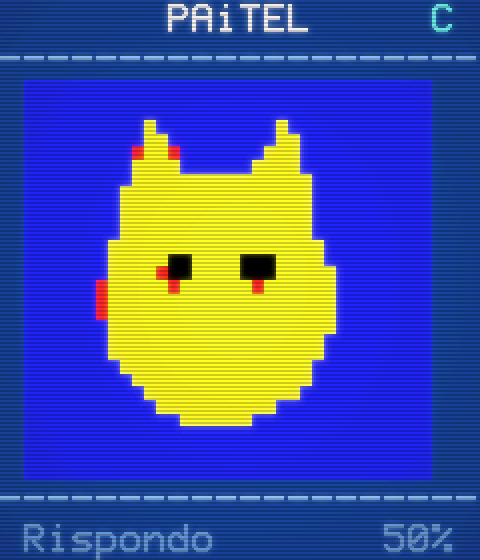
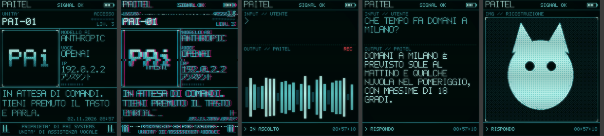
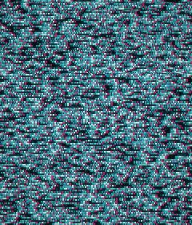

# Interfaccia Videotex per Assistant-PAi

Un'interfaccia alternativa per il display del **PiSugar Whisplay** che trasforma l'assistente AI in un
terminale **Videotel / Minitel / Televideo** anni '80. Sostituisce solo la grafica del
[whisplay-ai-chatbot](https://github.com/PiSugar/whisplay-ai-chatbot). Voce, AI, pulsante e batteria
continuano a funzionare come prima.



## Cosa fa

- **Avvio "in linea":** il terminale compone il numero (`ATDT 165`, il numero di accesso del Videotel SIP)
  e riproduce il suono di un modem V.23: toni DTMF, squillo, tono di risposta e fischio a 1200/75 baud.
  Dopo il messaggio `CONNESSO 1200/75` la pagina iniziale arriva cella per cella, alla velocità di un
  vero modem.
- **Logo personalizzato** in grafica a mosaico (sestanti 2x3): si crea da un testo (`VTX_LOGO_TEXT`) o da
  un'immagine PNG/JPG (`VTX_LOGO_IMAGE`) convertita nella palette a 8 colori.
- **Dialogo in stile terminale:** la tua domanda compare in giallo con `>`, la risposta viene
  "trasmessa" carattere per carattere e segue la voce della sintesi vocale. Il testo vecchio scorre verso
  l'alto.
- **Indicatore `F`/`C`** in alto a destra, come sul Minitel: F = fine/riposo, C = connesso. Lampeggia
  mentre l'assistente ti ascolta.
- **Immagini generate dall'AI** mostrate come mosaico Videotex, con al massimo 2 colori per cella come
  sui terminali veri, oppure come foto (`VTX_IMAGE_MODE=photo`).
- **Font bitmap 5x7** con smussatura delle diagonali come il chip Teletext SAA5050, lettere accentate
  italiane, emoji rimosse automaticamente.
- **Effetto monitor CRT:** scanline, bagliore dei fosfori e vignettatura, regolabili.



### Temi ("multi standard")

| `VTX_THEME` | Ispirazione | Aspetto |
|---|---|---|
| `videotel` | Videotel SIP (Italia, 1985) | fondo blu, testo azzurro, logo a mosaico separato |
| `minitel` | Minitel 1 (Francia, 1982) | monocromatico; i colori diventano livelli di grigio come sull'originale |
| `televideo` | Televideo RAI / Teletext | fondo nero, 8 colori saturi, testata `P100` con ora e banda colorata |
| `fosfori` | terminale a fosfori verdi | verde su nero |
| `cyberpunk` | HUD pixel-art | vedi sotto |

## Stile "pixel cyberpunk"

Si attiva con `UI_STYLE=cyberpunk`, oppure con `VTX_THEME=cyberpunk`. È ispirato alle interfacce HUD
pixel-art: pannelli a linee sottili con angoli "a mirino", font a pixel a tratto singolo in maiuscolo,
tinte ciano/teal e immagini **ricostruite in pixel** con retinatura (dithering Bayer) su una rampa di
6 tinte.



- **Avvio glitch con il tuo logo** (`VTX_LOGO_IMAGE`):
  1. schermo di rumore statico;
  2. il logo compare tra spostamenti di bande, separazione RGB magenta/ciano e sfarfallii, e si
     stabilizza;
  3. la frase `VTX_TAGLINE` si scrive sotto il logo;
  4. scorre il log di sistema, con lo stato reale di rete e batteria;
  5. un taglio glitch porta alla pagina iniziale.

  Durante l'avvio viene riprodotto un suono di disturbi digitali.
- **Pagina iniziale "tessera"** con dati reali del dispositivo: sigla `VTX_UNIT_ID`, logo in pixel,
  modello AI e voce (da `LLM_SERVER` e `TTS_SERVER`), indirizzo IP, data e ora. Ci sono anche
  decorazioni in katakana (アシスタント = "assistente") e un codice a barre.
- **Dialogo a pannelli** `INPUT // UTENTE` e `OUTPUT`. Mentre l'assistente ascolta compaiono un
  indicatore `REC` e un equalizzatore animato; la risposta si scrive in sincronia con la voce.
- **Immagini generate** ricostruite in pixel, con una linea di scansione che le disegna dall'alto.
- **Glitch casuali** a riposo (`VTX_GLITCH`) e glitch a ogni cambio di pagina.

Avvio animato (anteprima generata dal codice):



```ini
UI_STYLE=cyberpunk
VTX_SERVICE_NAME=PAiTEL
VTX_LOGO_IMAGE=/home/pi/logo.png   # il tuo logo (PNG/JPG; meglio ad alto contrasto, sfondo scuro)
VTX_TAGLINE=SISTEMA NEURALE ONLINE
VTX_UNIT_ID=PAi-01
VTX_CYBER_PALETTE=teal             # teal | verde | ambra | viola
VTX_GLITCH=0.5                     # 0 = mai, 1 = frequenti
VTX_PIXEL=2                        # grandezza dei pixel delle immagini (1 = più dettaglio)
VTX_UPPERCASE=1                    # tutto maiuscolo
VTX_FOOTER_LINES=PROPRIETA' DI PAi SYSTEMS|UNITA' DI ASSISTENZA VOCALE
VTX_HOME_TEXT=In attesa di comandi. Tieni premuto il tasto e parla.
# VTX_KATAKANA=アシスタント          # disponibili: ア シ ス タ ン ト ネ ッ ー
# VTX_BOOT=full | quick | off
```

Prova senza Raspberry, con il tuo logo:
`VTX_LOGO_IMAGE=logo.png python3 preview.py out cyberpunk`
(crea anche `cyberpunk-avvio.gif`).

## Installazione (sul Raspberry Pi)

Prima devi aver completato la [GUIDA](../GUIDA.md) fino alla Fase 7 (chatbot funzionante). Poi:

```bash
cd ~
git clone -b claude/raspberry-pi-ai-assistant-vlgr75 https://github.com/retroCyberdan/Assistant-PAi.git
cd Assistant-PAi/videotex
bash install.sh            # oppure: bash install.sh /percorso/whisplay-ai-chatbot
```

Lo script:
1. salva l'interfaccia originale in `python/chatbot-ui.original.py`;
2. copia i moduli Videotex in `whisplay-ai-chatbot/python/`;
3. sostituisce `chatbot-ui.py` con un piccolo lanciatore che legge `UI_STYLE` dal file `.env`;
4. riavvia `chatbot.service`, se esiste.

Non serve ricompilare (`build.sh`): l'interfaccia è solo Python e usa librerie già installate
(Pillow e numpy).

**Per tornare all'interfaccia originale** scegli una di queste due strade:
- imposta `UI_STYLE=original` in `.env` e riavvia;
- esegui `bash uninstall.sh`.

**Per aggiornare il chatbot** (`git pull`): prima esegui `bash uninstall.sh`, poi `git pull` e
`bash build.sh`, infine di nuovo `bash install.sh`.

## Configurazione (file `~/whisplay-ai-chatbot/.env`)

```ini
UI_STYLE=videotex           # videotex | cyberpunk | original
VTX_THEME=videotel          # videotel | minitel | televideo | fosfori
VTX_SERVICE_NAME=PAiTEL     # nome in testata
VTX_LOGO_TEXT=PAi           # logo a mosaico generato dal testo (max ~6 caratteri)
# VTX_LOGO_IMAGE=/home/pi/logo.png   # oppure un'immagine (ha la precedenza sul testo)
# VTX_LOGO_MONO=1                    # immagine resa in un solo colore
VTX_HOME_LINES=Tieni premuto il|tasto e parla
VTX_BOOT=full               # full (modem + connessione) | quick (solo pagina) | off
VTX_DIAL=165                # numero composto all'avvio
VTX_MODEM_SOUND=1           # suono del modem
VTX_BAUD=1200               # velocità di disegno: 1200 = autentico, 4800 = più rapido
VTX_CRT=0.7                 # 0 = nessun effetto, 1 = massimo
VTX_IMAGE_MODE=mosaic       # mosaic | photo
VTX_SYNC_SPEECH=1           # il testo segue la voce
VTX_HOME_TIMEOUT=90         # secondi prima di tornare alla pagina iniziale
VTX_PAGE=100                # numero pagina (tema televideo)
# VTX_AUDIO_DEVICE=plughw:CARD=whisplaysound   # se il suono del modem esce dal dispositivo sbagliato
```

Dopo ogni modifica: `sudo systemctl restart chatbot.service`.

### Consigli per il logo
- Il logo ha a disposizione circa **40x24 "sotto-pixel"** (20 colonne x 8 righe di caratteri a mosaico).
- Le immagini più adatte sono semplici, ad alto contrasto, con pochi colori e senza sfumature.
  Le foto vengono ridotte e perdono molto dettaglio: è l'effetto Videotex.
- Con `VTX_LOGO_MONO=1` l'immagine viene convertita in bianco e nero e disegnata nel colore del tema.

## Provarla sul PC (senza Raspberry)

```bash
pip install pillow numpy
python3 preview.py anteprime                 # tutti i temi
VTX_LOGO_TEXT=CIAO python3 preview.py out videotel
```

Il comando genera dei PNG delle pagine principali: avvio, home, ascolto, risposta e fine.

## Come funziona

Il chatbot originale è diviso in due processi. Il processo **Node.js** gestisce microfono, AI e voce;
lo script **Python** `chatbot-ui.py` disegna sul display. I due comunicano con messaggi JSON su
`localhost:12345`. `videotex_ui.py` parla esattamente lo stesso protocollo: riceve stato, testo,
batteria e immagini, e rimanda gli eventi del pulsante. Così il resto del chatbot non va modificato.

| File | Contenuto |
|---|---|
| `videotex_ui.py` | server socket, pagine, sequenza di avvio, suono del modem |
| `vtx_render.py` | griglia a caratteri, mosaico a sestanti, temi, effetto CRT |
| `vtx_font.py` | font bitmap 5x7 originale con lettere accentate e katakana |
| `vtx_cyber.py` / `cyber_ui.py` | stile pixel cyberpunk: pixel art, glitch, pagine HUD |
| `preview.py` | anteprime PNG senza hardware |
| `install.sh` / `uninstall.sh` | installazione e ripristino |

Limitazioni attuali: lo scorrimento è automatico (si vedono le ultime 10 righe) e la modalità
fotocamera usa ancora la grafica originale.
